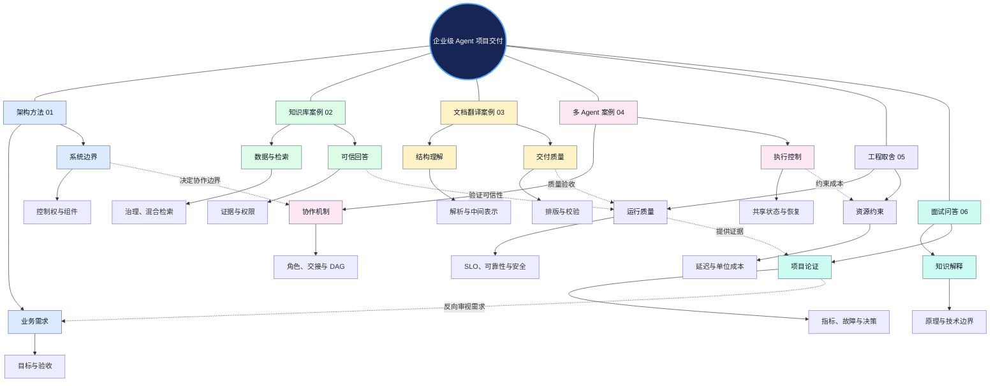
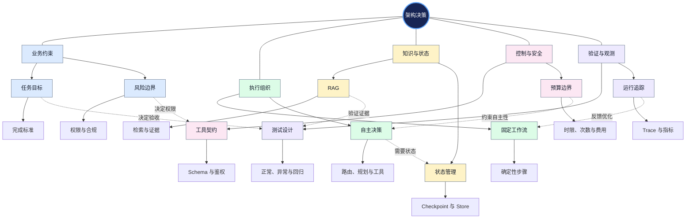
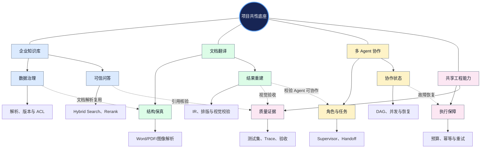
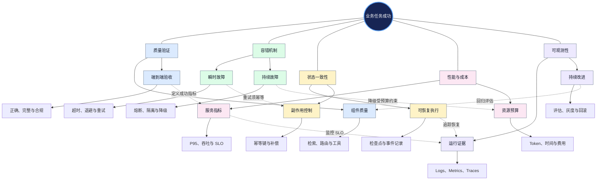
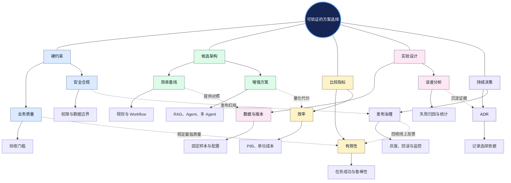
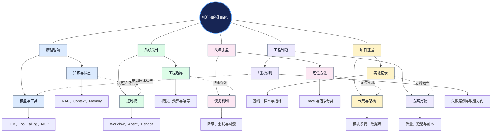

# 第八章｜项目实战与面试：从业务需求到可验证的 Agent 工程交付

> **章节定位**：本章不是 Agent 名词汇总，而是把前七章的模型、工具、RAG、上下文、工作流、多 Agent、可观测性和安全治理能力，转化为<strong>可设计、可实现、可测试、可解释的企业项目</strong>。  
> **阅读对象**：希望系统设计企业级 Agent、准备项目答辩或技术面试的开发者。  
> **阅读原则**：先理解共性工程方法，再比较三类项目，最后以数据与证据回答面试问题。文中项目场景与指标示例是设计方法说明，不能视为已交付系统的真实测量结果。

## 章节导览

- [一、章节总览：六篇文档如何构成完整知识体系](#一章节总览六篇文档如何构成完整知识体系)
- [二、项目设计：业务目标如何转化为 Agent 架构](#二项目设计业务目标如何转化为-agent-架构)
- [三、三类项目：共同底座与不同技术重点](#三三类项目共同底座与不同技术重点)
- [四、企业级交付：质量、可靠性、性能与安全闭环](#四企业级交付质量可靠性性能与安全闭环)
- [五、工程取舍：如何证明方案值得采用](#五工程取舍如何证明方案值得采用)
- [六、项目面试：从技术知识到可验证的工程表达](#六项目面试从技术知识到可验证的工程表达)
- [七、推荐学习路径与文档导航](#七推荐学习路径与文档导航)
- [八、核心概念辨析与跨章节关联](#八核心概念辨析与跨章节关联)
- [九、本章总结与参考入口](#九本章总结与参考入口)

---

## 一、章节总览：六篇文档如何构成完整知识体系

六篇文档不是彼此独立的案例：**01** 提供可复用的架构方法，**02–04** 分别验证知识密集、文档结构密集和协作密集任务的设计差异，**05** 用可靠性与成本等指标审视这些方案，**06** 把设计依据、失败处理与实验结论转化为可追问的技术表达。学习时应在项目与工程约束之间反复往返，而非只按文件顺序背诵。

### 1.1 全章中心辐射知识网络

中心是“可验证的企业级 Agent 交付”；六个分支分别对应六篇正文。虚线表达跨文档的反馈与依赖。

**图谱解读**：项目架构不是一次性产物。业务目标决定技术边界，具体案例暴露风险，运行指标反过来推动架构修正；面试能力来自这一整条证据链，而不是独立背题。

### 1.2 六篇文档的角色

| 文档 | 核心问题 | 在本章中的作用 |
|---|---|---|
| [01 项目需求、技术架构与关键决策](./01-Project-Architecture.md) | 需求如何变成架构和验收标准？ | 共性设计方法与技术选型基线 |
| [02 企业知识库助手](./02-Enterprise-Knowledge-Assistant.md) | 如何把私有知识转化为有证据、守权限的回答与行动？ | 数据治理、检索、可信生成的案例 |
| [03 智能文档翻译 Agent](./03-Document-Translation-Agent.md) | 如何保留内容、结构与视觉效果并交付文件？ | 多模态解析、IR、约束排版与质量闭环的案例 |
| [04 多 Agent 项目设计](./04-Multi-Agent-Project.md) | 什么时候协作优于单 Agent，如何控制交接与状态？ | 角色分工、任务图、并发和恢复的案例 |
| [05 可靠性、质量、成本与工程取舍](./05-Engineering-Tradeoffs.md) | 方案如何在真实约束下稳定、经济地运行？ | 横跨三个项目的生产级验收框架 |
| [06 核心知识、项目难点与面试问答](./06-Interview-Questions.md) | 如何解释原理、展示证据并应对追问？ | 知识迁移、故障分析与技术表达 |

---

## 二、项目设计：业务目标如何转化为 Agent 架构

系统设计首先要识别任务的<strong>成功条件与不可突破的边界</strong>。用户说“建立知识助手”并不等于只需要问答；用户说“翻译 PDF”也不等于只需要文本翻译。需求必须进一步分解为业务目标、功能能力、非功能属性和可执行的验收规则。

随后才决定：哪些环节用确定性程序，哪些交给 LLM（Large Language Model，大语言模型）进行语义判断；是否需要 RAG（Retrieval-Augmented Generation，检索增强生成）；是否值得引入多个 Agent。

### 2.1 从需求到架构的依赖网络

以“架构决策”为中心，同时连接输入条件、技术选项、控制机制和验证方式。

**图谱解读**：RAG、工具、状态和 Agent 不是互相替代的“架构选项”，而是解决不同问题的能力。真正的选型问题是<strong>哪些任务需要这些能力、由谁控制执行，以及怎样证明它们带来了收益</strong>。

### 2.2 四个必须分开的设计边界

| 边界 | 关键判断 | 典型误区 |
|---|---|---|
| 规则与模型 | 可确定验证的步骤是否由程序控制？ | 把所有流程都交给模型自主选择 |
| 数据与指令 | 检索内容、文件内容是否仅作为非可信数据？ | 让文档内容改变系统权限 |
| 状态与记忆 | 当前执行快照是否需要与跨会话知识分开？ | 把聊天记录等同于持久化状态 |
| 结果与副作用 | 工具返回成功是否等于业务操作安全完成？ | 忽略幂等、审批和重复执行 |

从需求分析到架构设计的详细方法，见 [01 项目架构设计](./01-Project-Architecture.md)。

---

## 三、三类项目：共同底座与不同技术重点

三个案例共享<strong>输入治理、执行控制、状态记录、质量验证和权限边界</strong>，但主导复杂度不同：知识库助手的难点是证据与权限，文档翻译的难点是结构与可交付性，多 Agent 的难点是控制权、协作与恢复。不能将一种项目的最优设计机械复制到另一种项目。

### 3.1 三类项目的共性与差异网络

中心是项目共性底座；外圈按业务对象形成三条不同的技术链路，并由质量与权限连接。

**图谱解读**：同样使用 LLM，知识库主要验证“回答依据”，翻译主要验证“内容与结构交付”，多 Agent 主要验证“分工收益”。三者都必须有独立于模型自述的业务验收。

### 3.2 三类项目的关键产物与评价方式

| 案例 | 关键技术链路 | 最重要的验收对象 | 首先关注的风险 |
|---|---|---|---|
| [企业知识库助手](./02-Enterprise-Knowledge-Assistant.md) | 数据接入 → 分块索引 → 混合检索 → 重排 → 证据生成 | 有权限的可信回答或受控操作 | 错误引用、越权、知识过期 |
| [文档翻译 Agent](./03-Document-Translation-Agent.md) | 格式识别 → 解析 → IR → 翻译 → 约束排版 → 校验 | 内容准确、结构可用、文件可打开 | 漏译、阅读顺序错误、版面错位 |
| [多 Agent 系统](./04-Multi-Agent-Project.md) | 任务分解 → 角色调度 → 工具调用 → 汇聚 → 验证 | 可复现的任务完成与协作收益 | 重复执行、交接循环、状态冲突 |

### 3.3 三种“正确性”的不同层次

<strong>语义正确</strong>指答案或译文表达准确；<strong>结构正确</strong>指对象关系、文档格式或任务依赖没有被破坏；<strong>业务正确</strong>指最终操作满足验收条件且遵守权限。这三种正确性可能彼此独立：翻译准确但表格错位，仍然可能交付失败；答案正确但访问了无权限数据，仍然属于安全失败。

---

## 四、企业级交付：质量、可靠性、性能与安全闭环

项目能在演示环境运行，只证明某些样例能够通过。生产交付需要处理长期运行中的模型波动、工具故障、用户输入变化、外部依赖限流和不可逆副作用。因此，质量工程必须与可靠性工程共同设计，而不是最后再添加日志或异常捕获。

### 4.1 生产交付的质量与可靠性网络

中心是业务任务成功；图中将质量判定、运行容错、状态一致性、资源限制和观测反馈连接起来。

**图谱解读**：可靠性不等于 HTTP 请求成功率。完整任务可能包含多次模型调用和外部副作用，任何关键环节失败都可能导致业务失败；重试需要幂等，降级需要守住质量与安全底线，而监控必须能定位具体失败节点。

### 4.2 最小可用的生产验收体系

- <strong>业务验收</strong>：为任务定义成功、部分成功、拒绝和失败的判定标准。
- <strong>离线回归</strong>：覆盖正常样本、复杂样本、边界输入、恶意输入和历史故障。
- <strong>故障注入</strong>：验证超时、429、服务异常、Worker 崩溃和重复调用。
- <strong>运行指标</strong>：同时观察任务成功率、P95/P99 延迟、费用、人工接管和安全事件。
- <strong>发布控制</strong>：固定模型、Prompt、工具和索引版本，灰度验证后再推广。

SLI（Service Level Indicator，服务等级指标）衡量实际行为；SLO（Service Level Objective，服务等级目标）规定目标阈值；SLA（Service Level Agreement，服务等级协议）是服务承诺。它们的适用窗口和统计分母必须明确，不能把接口可用性直接当作任务成功率。

关于熔断、检查点、Saga、质量评估、成本与预算，详见 [05 工程取舍](./05-Engineering-Tradeoffs.md)。

---

## 五、工程取舍：如何证明方案值得采用

工程设计不是组件数量竞赛。复杂架构只有在可复现的任务集上带来足够的业务收益，才有采用理由。建议始终先建立<strong>最简单可行基线（Baseline）</strong>：固定流程、单 Agent 或传统程序，再比较 RAG、多 Agent、复杂校验等增量机制。

一个实用指标是“每成功任务成本”，它将所有请求的实际总支出与通过验收的任务数量联系起来：

$$
C_{\mathrm{success}} = \frac{C_{\mathrm{total}}}{N_{\mathrm{success}}}, \qquad N_{\mathrm{success}} > 0
$$

这里的成本应包括模型、检索、工具、计算、存储及必要的人工复核等可比项目。该指标不能取代质量、安全和延迟等硬约束。

### 5.1 多目标架构决策网络

围绕“选择可验证方案”，展示需求约束、候选架构、实验指标和发布反馈之间的双向关系。

**图谱解读**：工程选型的起点是硬约束，不是偏好的框架；终点也不是“模型分数更高”，而是可复现的任务收益和可接受的运维代价。ADR（Architecture Decision Record，架构决策记录）用于保存备选方案、依据和已知风险。

### 5.2 三组典型取舍

| 决策 | 倾向简单方案的条件 | 值得升级的条件 |
|---|---|---|
| Workflow → Agent | 路径明确、可规则化 | 任务需要根据证据动态选择行动 |
| 单 Agent → 多 Agent | 职责紧密、交接收益小 | 专业分工、权限隔离或并行带来可测收益 |
| 一次生成 → 校验修正 | 结果可直接程序验证且风险低 | 错误代价高，独立校验能降低实际缺陷 |

需要注意，增加模型轮次可能提高部分任务质量，也可能放大延迟、费用和故障概率。真正的选择依据应是相同测试集和相同验收标准下的比较。详见 [05 工程取舍](./05-Engineering-Tradeoffs.md)。

---

## 六、项目面试：从技术知识到可验证的工程表达

面试不应把 Agent 基础、RAG、Memory、工具和多 Agent 当作互不相干的名词。高质量回答要说明：<strong>业务为什么提出问题 → 技术为什么能解决 → 代码如何实现 → 如何验证有效 → 有哪些失败边界 → 为什么没有采用其他方案</strong>。

### 6.1 面试能力迁移网络

以“可追问的项目论证”为中心，把技术理解、架构选择、实现证据、失败分析和量化实验连接起来。

**图谱解读**：技术问答与项目答辩的区别在于证据。能够解释 RRF（Reciprocal Rank Fusion，倒数排名融合）公式只是知识；能够说明为什么在某类文档上使用混合检索、怎样设计对照实验、失败样本在哪里，才是工程能力。

### 6.2 面试复盘时应准备的证据

| 证据 | 面试官想确认什么 |
|---|---|
| 业务需求与验收定义 | 是否理解真实问题，而非只会堆技术 |
| 架构图与模块边界 | 是否亲自设计或深入实现过系统 |
| 关键代码与接口契约 | 是否能解释执行机制和状态流转 |
| 测试集、基线与指标 | 是否能证明改进而非凭感觉判断 |
| Trace、失败样本与修复记录 | 是否具备定位和恢复能力 |
| ADR 与方案对比 | 是否理解工程代价和适用边界 |

可按“简答 → 原理 → 项目实现 → 证据 → 取舍 → 追问”复习 [06 核心知识、项目难点与面试问答](./06-Interview-Questions.md)。项目中的假设场景与示例指标不得包装为真实上线成果。

---

## 七、推荐学习路径与文档导航

### 7.1 第一次阅读：建立整体设计能力

先读 [01 项目架构](./01-Project-Architecture.md)，明确业务目标、模块边界、架构视图与验收指标；再选择一个最熟悉的项目案例，按照“输入 → 处理 → 状态 → 输出 → 验收”追踪完整链路。随后阅读 [05 工程取舍](./05-Engineering-Tradeoffs.md)，检查该案例是否具有可靠性、安全与成本边界，最后使用 [06 面试问答](./06-Interview-Questions.md)进行口述复盘。

### 7.2 第二次阅读：按项目方向深入

| 学习目标 | 建议顺序 | 应形成的产物 |
|---|---|---|
| 企业 RAG / 知识库 | [01 架构](./01-Project-Architecture.md) → [02 知识库](./02-Enterprise-Knowledge-Assistant.md) → [05 取舍](./05-Engineering-Tradeoffs.md) → [06 面试](./06-Interview-Questions.md) | 检索评估表、权限模型、可信回答链路 |
| 文档与多模态 Agent | [01 架构](./01-Project-Architecture.md) → [03 文档翻译](./03-Document-Translation-Agent.md) → [05 取舍](./05-Engineering-Tradeoffs.md) → [06 面试](./06-Interview-Questions.md) | IR 设计、版面质量指标、回归测试矩阵 |
| 多 Agent / 复杂任务编排 | [01 架构](./01-Project-Architecture.md) → [04 多 Agent](./04-Multi-Agent-Project.md) → [05 取舍](./05-Engineering-Tradeoffs.md) → [06 面试](./06-Interview-Questions.md) | DAG、交接协议、恢复方案、单 Agent 对照 |

### 7.3 第三次阅读：跨项目比较

比较三个案例中<strong>控制权归属、知识与状态的使用、业务验收、故障恢复和成本构成</strong>。建议为每个案例各写一份简短 ADR，并对同一个工程问题给出至少两种候选方案及选择依据。

---

## 八、核心概念辨析与跨章节关联

### 8.1 不能混为一谈的概念

| 概念对 | 关键区别 | 对应正文 |
|---|---|---|
| Workflow / Agent | 预设控制路径 / 在边界内动态决策 | [01](./01-Project-Architecture.md)、[04](./04-Multi-Agent-Project.md) |
| RAG / Memory | 为当前任务检索外部证据 / 管理跨步骤或跨会话信息 | [02](./02-Enterprise-Knowledge-Assistant.md)、[06](./06-Interview-Questions.md) |
| Tool Calling / MCP | 发起结构化工具调用 / 标准化工具与资源集成协议 | [04](./04-Multi-Agent-Project.md)、[06](./06-Interview-Questions.md) |
| Checkpoint / 幂等 | 恢复执行状态 / 防止重复副作用 | [04](./04-Multi-Agent-Project.md)、[05](./05-Engineering-Tradeoffs.md) |
| 质量 / 可用性 | 结果是否满足要求 / 服务是否可访问 | [05](./05-Engineering-Tradeoffs.md) |
| Trace / Evaluation | 记录发生的执行过程 / 判断是否符合要求 | [05](./05-Engineering-Tradeoffs.md)、[06](./06-Interview-Questions.md) |
| 单次调用成本 / 成功任务成本 | 一次请求的费用 / 完整业务交付的有效成本 | [05](./05-Engineering-Tradeoffs.md) |

### 8.2 与前七章的关系

本章将前七章知识从“组件能力”提升为“项目设计与交付能力”：

- [01 LLM Fundamentals](../01-LLM-Fundamentals/) 提供模型能力、推理与成本的基础。
- [02 Agent Fundamentals](../02-Agent-Fundamentals/) 提供 Agent 定义、任务决策与基本架构。
- [03 Agent Core Components](../03-Agent-Core-Components/) 提供状态、上下文、工具等组成能力。
- [04 Agent Working Patterns](../04-Agent-Working-Patterns/) 提供 ReAct、规划与工作流模式。
- [05 Agent Knowledge and Tools](../05-Agent-Knowledge-and-Tools/) 提供 RAG、检索与工具集成知识。
- [06 Multi-Agent and Frameworks](../06-Multi-Agent-and-Frameworks/) 提供多 Agent 模式和框架。
- [07 Enterprise Engineering and Deployment](../07-Enterprise-Engineering-and-Deployment/) 提供生产工程、安全、部署与治理视角。

上述路径为章节级目录导航；各章节的细节仍以其 README 和正文为准。

---

## 九、本章总结与参考入口

<strong>本章最重要的知识关联</strong>可以概括为：业务目标定义验收，验收约束架构，架构决定执行与状态机制，执行产生可观测数据，数据支持质量和成本评估，评估再驱动架构优化；面试则是对这一完整决策链的解释与论证。

读完本章，至少应能够独立完成以下四件事：

1. 根据业务目标设计可验证的 Agent 系统，而非先选框架再找场景。
2. 解释企业知识库、文档翻译和多 Agent 协作三类项目的不同难点与共同底座。
3. 在失败、超时、成本和安全约束下设计可恢复、可监控的执行机制。
4. 用真实代码、测试数据、故障复盘与架构决策记录支撑项目答辩。

### 权威资料入口

本 README 聚焦知识导航；各篇正文包含更完整的技术来源和适用边界。进一步核对实现细节，可优先参考：

- [LangGraph 官方文档](https://docs.langchain.com/oss/python/langgraph/overview)：状态图、持久化与执行控制。
- [OpenAI Agents SDK](https://openai.github.io/openai-agents-python/)：工具、Handoff、Guardrails 与 Tracing。
- [Microsoft Azure Architecture Center](https://learn.microsoft.com/en-us/azure/architecture/patterns/)：分布式可靠性模式。
- [Google SRE](https://sre.google/books/)：SLO、错误预算与生产可靠性。
- [OpenTelemetry](https://opentelemetry.io/docs/)：指标、日志和分布式追踪。
- [OWASP GenAI Security](https://genai.owasp.org/)：LLM 与 Agent 的安全边界。

> **学习建议**：不要以“读完六篇文档”作为终点。真正的完成标准，是能够拿出一套可解释的项目架构、一份可复现的测试报告，以及对失败边界和工程取舍的清楚说明。

